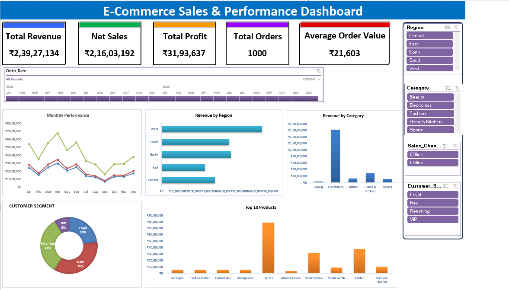

# 🛒 E-Commerce Sales Analysis & Interactive Excel Dashboard

An Excel portfolio project analyzing e-commerce sales performance across products, customer segments, regions, and monthly trends. The repository includes the complete workbook, a separate dashboard workbook, a dashboard preview, and supporting documentation.

## 📊 Dashboard Preview



*This is a static preview. Download the Excel dashboard below to explore the workbook and its Excel features.*

## 📥 Download the Excel files

| File | Description |
|---|---|
| [Ecommerce_Sales_Dashboard.xlsx](Ecommerce_Sales_Dashboard.xlsx) | Separate dashboard-focused Excel workbook |
| [Ecommerce_Sales.xlsx](data/Ecommerce_Sales.xlsx) | Complete workbook with source data and supporting analysis |

Open the workbook in Microsoft Excel and select the **Dashboard** sheet. GitHub can display the preview image, but it cannot run Excel slicers, PivotTables, or chart interactions inside the README.

## Project at a glance

| Metric | Value |
|---|---:|
| Total orders | 1,000 |
| Total revenue | 23,927,133.50 |
| Net sales | 21,603,192.00 |
| Total profit | 3,193,636.54 |
| Average order value | 21,603.19 |

*The source workbook does not explicitly identify the currency, so amounts are shown without a currency symbol.*

## 🎯 Project Objectives

- Analyze monthly sales performance.
- Compare revenue across regions and product categories.
- Understand customer-segment performance.
- Identify the top 10 products by net sales.
- Track revenue, net sales, profit, order count, and average order value.
- Present findings through an Excel dashboard.

## 🧰 Tools & Skills

- Microsoft Excel
- PivotTables and PivotCharts
- KPI reporting
- Sales and profitability analysis
- Data summarization
- Dashboard design and data visualization

## 📁 Workbook Contents

The original workbook contains these worksheets:

| Worksheet | Purpose |
|---|---|
| `Dashboard` | Main E-Commerce Sales & Performance Dashboard |
| `Sales_Data` | Source sales records |
| `KPI` | KPI calculations |
| `kpl cards` | Supporting KPI card values |
| `monthly performance` | Monthly sales and profit analysis |
| `Revenue by Region` | Regional revenue analysis |
| `Revenue by Category` | Category revenue analysis |
| `Customer Segment` | Customer segment analysis |
| `Top 10 Products` | Best-performing products |

## 🔍 Key Findings

- **April** is the strongest month by net sales (2,977,764.00).
- **West** is the leading region by net sales (6,507,672.00).
- **Electronics** is the leading category by net sales (16,225,989.50).
- **New** customers contribute the highest net sales (7,719,442.00).
- **Laptop** is the top product by net sales (7,857,071.50).

See [`documentation/project-insights.md`](documentation/project-insights.md) for detailed tables and observations.

## 🚀 How to Use

1. Download either Excel workbook using the links above.
2. Open it in Microsoft Excel.
3. Navigate to the **Dashboard** sheet.
4. Use the slicers to filter the dashboard, where supported by your Excel version.
5. Explore the other worksheets for supporting calculations and analysis.

## 📂 Repository Structure

```text
ecommerce-sales-analysis-excel/
├── Ecommerce_Sales_Dashboard.xlsx
├── README.md
├── .gitignore
├── data/
│   └── Ecommerce_Sales.xlsx
├── documentation/
│   ├── project-insights.md
│   └── data-dictionary.md
└── screenshots/
    └── Dashboard_Preview.png
```

## 📝 Data Notes

- The source workbook contains 1,000 order records and 21 fields in `Sales_Data`.
- Summary metrics are based on the workbook's existing KPI and summary sheets.
- Currency is not explicitly specified in the source workbook.
- These findings describe the supplied dataset and are not industry-wide statistics.

## 👨‍💻 Author

**Prajyot Gharat**  
B.Sc. Computer Science | Interested in Data Analytics, AI, and Machine Learning
