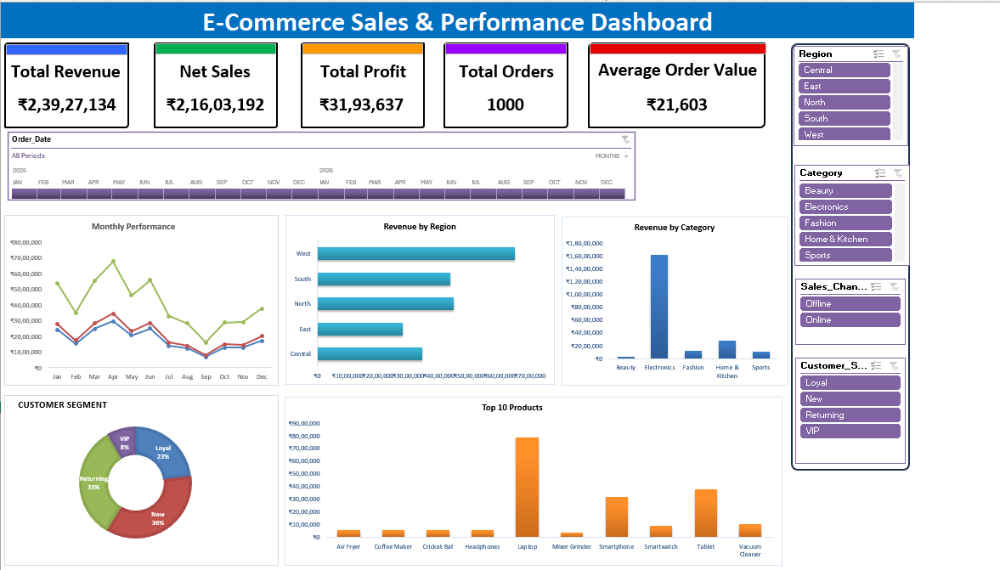

# E-Commerce Sales Analysis — Project Insights

*Static dashboard preview. Download `Ecommerce_Sales_Dashboard.xlsx` from the repository root to explore the Excel workbook.*

> **Data note:** The figures below are taken from the supplied workbook's existing KPI and pivot-summary worksheets. Currency is not explicitly identified in the workbook, so amounts are shown without a currency symbol.

## 1. Overall KPI Summary

| KPI | Value |
|---|---:|
| Total orders | 1,000 |
| Total revenue | 23,927,133.50 |
| Net sales | 21,603,192.00 |
| Total profit | 3,193,636.54 |
| Average order value | 21,603.19 |

Average order value in the workbook is net sales divided by the 1,000 orders.

## 2. Monthly Performance

| Month | Net sales | Profit | Revenue |
|---|---:|---:|---:|
| Jan | 2,430,193.50 | 341,707.73 | 2,603,158.00 |
| Feb | 1,534,735.00 | 218,582.73 | 1,754,219.00 |
| Mar | 2,482,171.00 | 334,339.60 | 2,718,186.00 |
| Apr | 2,977,764.00 | 484,963.95 | 3,312,753.50 |
| May | 2,066,869.00 | 285,768.52 | 2,269,487.50 |
| Jun | 2,501,022.00 | 358,567.17 | 2,725,985.50 |
| Jul | 1,404,370.00 | 212,160.54 | 1,672,630.00 |
| Aug | 1,239,731.50 | 163,610.72 | 1,436,475.50 |
| Sep | 687,731.50 | 106,829.18 | 802,478.00 |
| Oct | 1,277,193.00 | 214,251.91 | 1,402,227.00 |
| Nov | 1,272,626.00 | 179,274.34 | 1,471,073.00 |
| Dec | 1,728,785.50 | 293,580.15 | 1,758,460.50 |

**Insight:** April records the highest net sales (2,977,764.00) and profit (484,963.95). September records the lowest net sales (687,731.50).

## 3. Net Sales by Region

| Region | Net sales |
|---|---:|
| West | 6,507,672.00 |
| North | 4,476,680.50 |
| South | 4,374,252.00 |
| Central | 3,439,756.50 |
| East | 2,804,831.00 |

**Insight:** West is the strongest region by net sales.

## 4. Net Sales by Category

| Category | Net sales |
|---|---:|
| Electronics | 16,225,989.50 |
| Home & Kitchen | 2,820,063.50 |
| Fashion | 1,261,598.00 |
| Sports | 1,025,962.50 |
| Beauty | 269,578.50 |

**Insight:** Electronics contributes the largest net sales in this dataset.

## 5. Net Sales by Customer Segment

| Customer segment | Net sales |
|---|---:|
| New | 7,719,442.00 |
| Returning | 7,100,859.00 |
| Loyal | 4,980,838.50 |
| VIP | 1,802,052.50 |

**Insight:** New customers have the highest net sales, followed by Returning customers.

## 6. Top 10 Products by Net Sales

| Product | Net sales |
|---|---:|
| Laptop | 7,857,071.50 |
| Tablet | 3,752,927.00 |
| Smartphone | 3,149,442.50 |
| Vacuum Cleaner | 1,037,812.00 |
| Smartwatch | 875,653.50 |
| Headphones | 590,895.00 |
| Coffee Maker | 564,263.50 |
| Cricket Bat | 534,263.00 |
| Air Fryer | 530,963.00 |
| Mixer Grinder | 386,134.50 |

**Insight:** Laptop is the top product by net sales in the workbook summary.

## 7. Business Questions Answered

- Which month has the highest net sales? **April.**
- Which region leads net sales? **West.**
- Which category leads net sales? **Electronics.**
- Which customer segment leads net sales? **New.**
- Which product leads net sales? **Laptop.**

## 8. Recommendations for Further Analysis

- Compare profit margins across regions and categories, not only sales volume.
- Investigate the strong Electronics contribution and product concentration.
- Review September's lower sales alongside order counts, discounts, and product mix.
- Compare customer segments by sales channel, payment method, and order status.
- Make currency and unit labels explicit in the dashboard before formal reporting.
